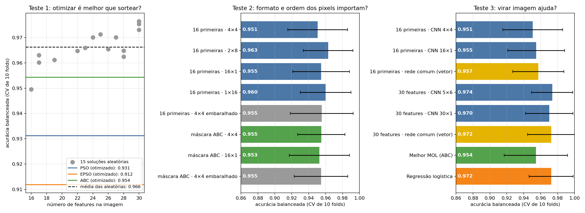

# Testes de controle do MOL

Três testes para verificar se cada parte do MOL contribui para a classificação.
Protocolo igual ao do experimento principal: mesmo split treino/teste, os mesmos 10 folds
estratificados, grid da taxa de aprendizado (1e-1 a 1e-4), 100 épocas, acurácia balanceada.
O escalonamento e o ranking do Map (distância euclidiana) são refeitos dentro de cada fold.
As comparações usam o teste de Wilcoxon pareado nos 10 folds.

## Teste 1: otimizar é melhor que sortear?

15 soluções com formato e máscara sorteados (a mesma distribuição da população inicial dos enxames),
contra as soluções otimizadas do experimento principal.

| Solução | Acurácia balanceada (CV) |
|---|---|
| 15 aleatórias: média (mínimo a máximo) | 0,966 (0,950 a 0,977) |
| ABC otimizado | 0,954 |
| PSO otimizado | 0,931 |
| EPSO otimizado | 0,912 |

- As 15 aleatórias superam o PSO e o EPSO (p = 0,008 e p = 0,004), e 14 das 15 superam o ABC (p = 0,30, não significativo).
- Nas aleatórias, a acurácia acompanha o número de features (correlação 0,79). As de 30 features chegam a 0,973–0,977; as de 16–17 ficam em 0,950–0,963, no nível do ABC (16 features).
- Conclusão: o que explica o desempenho é quantas features entram, e a Eq. 1 empurra para poucas. Otimizar a Eq. 1 piora o resultado em relação a sortear.

## Teste 2: o formato 2D e a ordem do Map importam?

As mesmas 16 features, só mudando o formato ou a ordem dos pixels.

| Configuração | 16 primeiras do ranking | Máscara do ABC |
|---|---|---|
| 4×4 | 0,951 | 0,955 |
| 2×8 | 0,963 | — |
| 16×1 | 0,955 | 0,953 |
| 1×16 | 0,960 | — |
| 4×4 com pixels embaralhados (média) | 0,955 | 0,955 |

- Nenhuma diferença é significativa (p entre 0,28 e 0,81).
- O 4×4 não é melhor que o vetor 16×1, e embaralhar os pixels não piora.
- Conclusão: nem o formato 2D nem a ordem do Map nos pixels fazem diferença mensurável nesta base.

## Teste 3: transformar em imagem ajuda?

As mesmas features numa rede neural comum (vetor, sem convolução), com a mesma camada oculta e o mesmo treino.

| Features | CNN (imagem) | Rede comum (vetor) |
|---|---|---|
| 16 primeiras | 0,951 (4×4) · 0,955 (16×1) | 0,957 |
| Máscara do ABC (16) | 0,953 (16×1) | 0,964 |
| Todas as 30 | 0,974 (5×6) · 0,970 (30×1) | 0,972 |

- Nenhuma diferença é significativa (p entre 0,28 e 1,00).
- Referências do experimento principal: melhor MOL (ABC) 0,954; regressão logística 0,972.
- Conclusão: a convolução não acrescenta nada em relação a uma rede comum com as mesmas features.

## Limitações

- Uma única base (569 pacientes) em que quase todo modelo passa de 0,95; diferenças de 1 ponto ficam dentro do ruído dos folds.
- Uma única semente de inicialização das redes por configuração.
- A máscara do ABC usada nos testes 2 e 3 foi ajustada no treino inteiro (no experimento principal ela é refeita em cada fold). O resultado fixo (0,953) bate com o do experimento principal (0,954).
- O teste 1 não separa "aleatório" de "mais features": as soluções sorteadas têm de 16 a 30 features. Com o mesmo número de features (16–17), aleatório e ABC empatam.

## Arquivos

- `experimentos/controles.py`: roda os testes (~35 min).
- `experimentos/analisar_controles.py`: gera `resumo.csv`, `comparacoes.csv` e `grafico.png`.
- `resultados.csv`, `fold_scores.csv`: resultados brutos por configuração e por fold.
- `log_execucao.txt`: log da execução.
