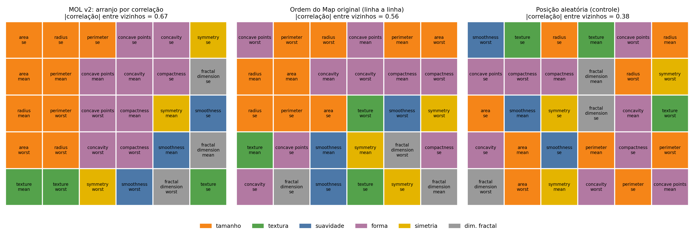
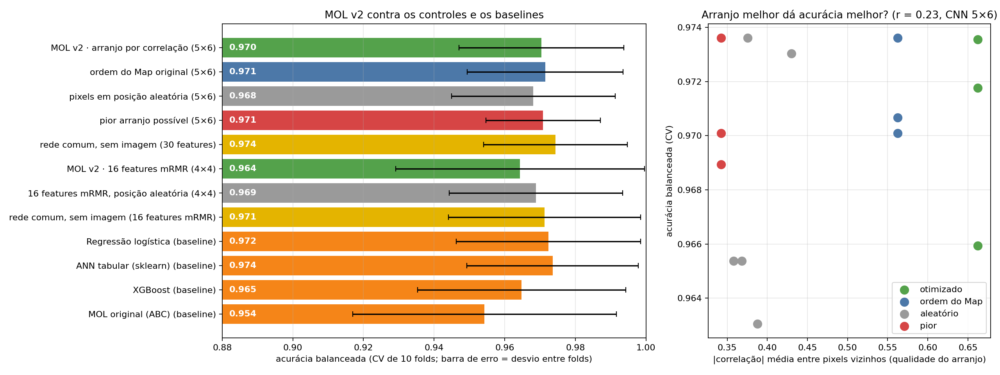

# MOL v2: versão corrigida e o que ela mostrou

## O que foi construído

O MOL v2 corrige os três defeitos de projeto do MOL original:

| Defeito do MOL original | Correção no v2 |
|---|---|
| A Eq. 1 ignora a posição dos pixels | O objetivo é a posição: features correlacionadas ficam em pixels vizinhos |
| A Eq. 1 ignora o formato (h e w saem ao acaso) | Formato fixo, o mais quadrado possível (30 features → 5×6) |
| O mínimo da Eq. 1 é sempre 2 features | O arranjo não descarta features; a seleção é separada, opcional e supervisionada (mRMR) |

A ideia do arranjo por similaridade vem da literatura de "tabela para imagem" (DeepInsight, REFINED, IGTD).
O objetivo usado segue o do IGTD: o ranking das distâncias entre pixels deve concordar com o ranking das
dissimilaridades (1 − |correlação|) entre features. A CNN é a mesma do artigo.

## O arranjo funciona como otimização

A correlação média entre pixels vizinhos sobe de 0,38 (aleatório) para 0,67 (otimizado). As medidas de
tamanho (raio, perímetro, área) ficam agrupadas, assim como as de forma. A ordem do Map original já
agrupa um pouco (0,56), porque as features mais importantes são correlacionadas entre si.

## Mas o arranjo não muda a classificação

Protocolo igual ao do experimento principal (mesmo split, os mesmos 10 folds, grid da taxa de aprendizado,
100 épocas, acurácia balanceada). Cada grupo é a média de 3 sementes de rede (ou 5 permutações, no aleatório).

| Configuração | Acurácia balanceada (CV) | \|corr\| entre vizinhos |
|---|---|---|
| Rede comum, sem imagem (30 features) | 0,974 | — |
| ANN tabular (baseline) | 0,974 | — |
| Regressão logística (baseline) | 0,972 | — |
| CNN 5×6, ordem do Map original | 0,971 | 0,56 |
| CNN 5×6, pior arranjo possível | 0,971 | 0,34 |
| **MOL v2: CNN 5×6, arranjo por correlação** | **0,970** | **0,66** |
| CNN 5×6, pixels em posição aleatória | 0,968 | 0,38 |
| XGBoost (baseline) | 0,965 | — |
| MOL v2 com 16 features mRMR (4×4) | 0,964 | 0,74 |
| MOL original (ABC) | 0,954 | — |

Testes de Wilcoxon pareados nos 10 folds (nenhum significativo):

| Pergunta | Diferença | p |
|---|---|---|
| Arranjo otimizado é melhor que pixels aleatórios? | +0,002 | 0,77 |
| Arranjo otimizado é melhor que o pior arranjo? | −0,001 | 0,88 |
| Arranjo otimizado é melhor que a ordem do Map original? | −0,001 | 0,73 |
| A imagem é melhor que o vetor numa rede comum? | −0,004 | 0,16 |
| MOL v2 é melhor que a regressão logística? | −0,002 | 0,61 |
| MOL v2 é melhor que o MOL original? | +0,016 | 0,14 |
| Usar as 30 é melhor que selecionar 16 por mRMR? | +0,006 | 0,25 |

A correlação entre a qualidade do arranjo e a acurácia, nas 14 execuções de CNN 5×6, é r = 0,23.

## Conclusões

1. **O v2 elimina o prejuízo do MOL original.** Sem a Eq. 1 descartando features, a acurácia volta para ~0,97,
   o nível dos baselines (0,970 contra 0,954 do MOL original; diferença não significativa, p = 0,14).
2. **O arranjo espacial não ajuda nesta base.** Otimizado, aleatório e pior arranjo empatam. O teste decisivo
   (embaralhamento) deu empate.
3. **Transformar em imagem não ajuda nesta base.** A rede comum com o vetor e a regressão logística ficam no
   mesmo nível ou ligeiramente acima.
4. **Selecionar features não ajudou.** Com 16 features mRMR o resultado é igual ou um pouco pior que com as 30.

## Limitações

- Todos os modelos estão num teto de ~0,97 nesta base. Com 455 pacientes de treino e 10 folds, diferenças
  menores que ~0,01 não são detectáveis. O experimento não consegue mostrar um ganho pequeno, se existir.
- Uma única base, pequena (30 features). Os métodos de imagem da literatura relatam ganhos em bases com
  centenas ou milhares de features correlacionadas; isso não foi testado aqui.
- A CNN é a do artigo (1 convolução). Arquiteturas maiores não foram testadas.
- O PSO do projeto resolveu mal o problema de permutação (erro 50 contra 21 da busca por trocas), por isso o
  padrão do v2 é a busca por trocas.

## Arquivos

- `src/mol/v2.py`: o algoritmo (`MOLv2Classifier`).
- `experimentos/mol_v2.py`: roda as 24 configurações (~25 min).
- `experimentos/analisar_mol_v2.py`: gera tabelas e figuras.
- `resultados.csv`, `fold_scores.csv`, `resumo.csv`, `comparacoes.csv`, `log_execucao.txt`.
